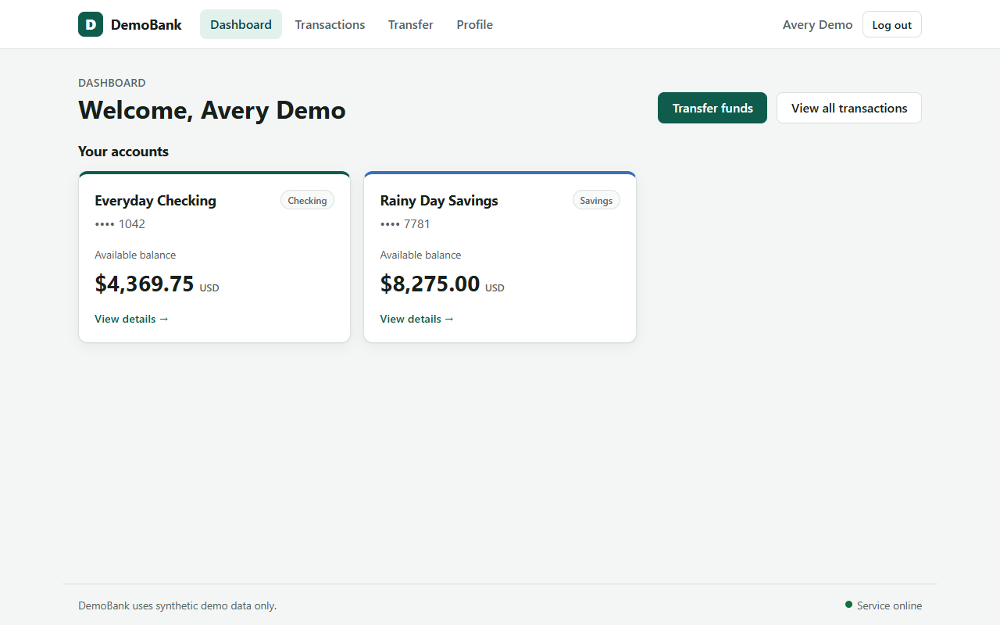

# DemoBank QA Audit

Generated: 2026-10-21T19:36:58.727721+00:00

**Verdicts:** 1 PASSED / 0 FAILED / 31 UNVERIFIED across 32 traceable PRD clauses.

**Ingestion:** Gemini gemini-3.5-flash-lite (source quotes preserved)

Execution blocked ≠ application failed. Unexecuted requirements stay UNVERIFIED.

## Requirement traceability

| PRD ID | Section | Verdict | Scenario(s) |
|---|---|---|---|
| PRD-001 | Users and access | **UNVERIFIED** | not yet implemented |
| PRD-002 | Users and access | **PASSED** | login |
| PRD-003 | Users and access | **UNVERIFIED** | not yet implemented |
| PRD-004 | Users and access | **UNVERIFIED** | not yet implemented |
| PRD-005 | Users and access | **UNVERIFIED** | not yet implemented |
| PRD-006 | Dashboard and accounts | **UNVERIFIED** | not yet implemented |
| PRD-007 | Dashboard and accounts | **UNVERIFIED** | not yet implemented |
| PRD-008 | Dashboard and accounts | **UNVERIFIED** | not yet implemented |
| PRD-009 | Dashboard and accounts | **UNVERIFIED** | not yet implemented |
| PRD-010 | Dashboard and accounts | **UNVERIFIED** | not yet implemented |
| PRD-011 | Transfers between owned accounts | **UNVERIFIED** | not yet implemented |
| PRD-012 | Transfers between owned accounts | **UNVERIFIED** | not yet implemented |
| PRD-013 | Transfers between owned accounts | **UNVERIFIED** | not yet implemented |
| PRD-014 | Transfers between owned accounts | **UNVERIFIED** | not yet implemented |
| PRD-015 | Transfers between owned accounts | **UNVERIFIED** | not yet implemented |
| PRD-016 | Transfers between owned accounts | **UNVERIFIED** | not yet implemented |
| PRD-017 | Transfers between owned accounts | **UNVERIFIED** | not yet implemented |
| PRD-018 | Transfers between owned accounts | **UNVERIFIED** | not yet implemented |
| PRD-019 | Transfers between owned accounts | **UNVERIFIED** | not yet implemented |
| PRD-020 | Transaction history | **UNVERIFIED** | not yet implemented |
| PRD-021 | Transaction history | **UNVERIFIED** | not yet implemented |
| PRD-022 | Transaction history | **UNVERIFIED** | not yet implemented |
| PRD-023 | Transaction history | **UNVERIFIED** | not yet implemented |
| PRD-024 | Transaction history | **UNVERIFIED** | not yet implemented |
| PRD-025 | Transaction history | **UNVERIFIED** | not yet implemented |
| PRD-026 | Profile | **UNVERIFIED** | not yet implemented |
| PRD-027 | Profile | **UNVERIFIED** | not yet implemented |
| PRD-028 | General interface behavior | **UNVERIFIED** | not yet implemented |
| PRD-029 | General interface behavior | **UNVERIFIED** | not yet implemented |
| PRD-030 | General interface behavior | **UNVERIFIED** | not yet implemented |
| PRD-031 | General interface behavior | **UNVERIFIED** | not yet implemented |
| PRD-032 | General interface behavior | **UNVERIFIED** | not yet implemented |

## Scenario-level evidence

### login — PASSED
- **Requirement:** PRD-002 (Users and access)
- **PRD quote:** The landing page provides a clearly labeled **Enter Demo** action. It opens the demo dashboard without requiring a password or real identity information.
- **Execution:** ok
- **Expected:** Dashboard with active customer and two account cards, no password
- **Observed:** URL=http://localhost:5173/dashboard, active=Signed in as
Avery Demo, cards=2
- **Rationale:** Verified resulting dashboard state after Enter Demo.
- **Reproduction steps:**
  1. Navigate to landing
  2. Click Enter Demo
  3. Assert dashboard and active customer
- **Screenshot (at assertion):** 
- **DOM excerpt:** `Skip to main content D DemoBank Dashboard Transactions Transfer Profile Signed in as Avery Demo Log out  DASHBOARD  Welcome, Avery Demo Transfer funds View all transactions Your accounts Everyday Checking Checking  Account number ending •••• 1042  Available balance  $4,369.75USD  View details → Rainy Day Savings Savings  Account number ending •••• 7781  Available balance  $8,275.00USD  View details → DemoBank uses synthetic demo data only. Service online`

## API / token cost

- LLM calls: 1
- Input tokens: 1378
- Output tokens: 2417
- Estimated API spend (USD): unavailable — configure pricing
- Replay/verification LLM calls: 0
- Note: Set INPUT_USD_PER_M_TOKENS and OUTPUT_USD_PER_M_TOKENS to estimate billed costs. Null means prices were not provided.

## Reset log

- login: migrations+seed reset OK
