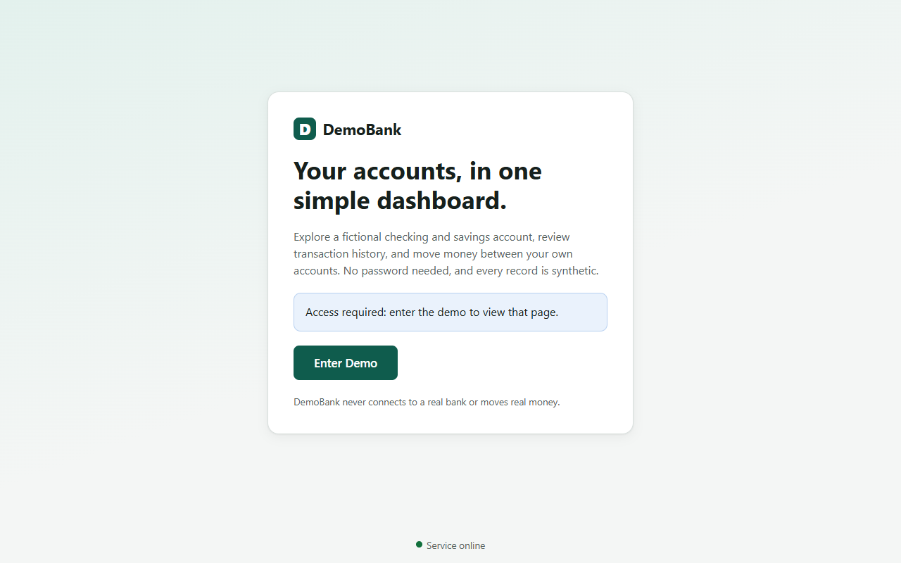
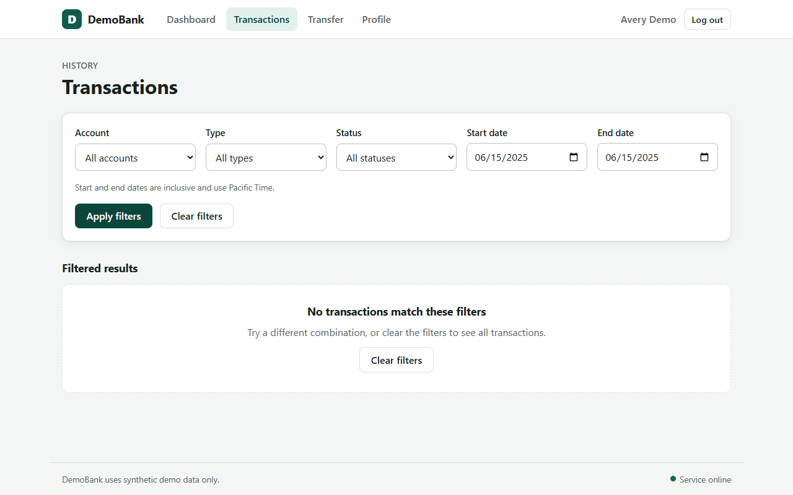
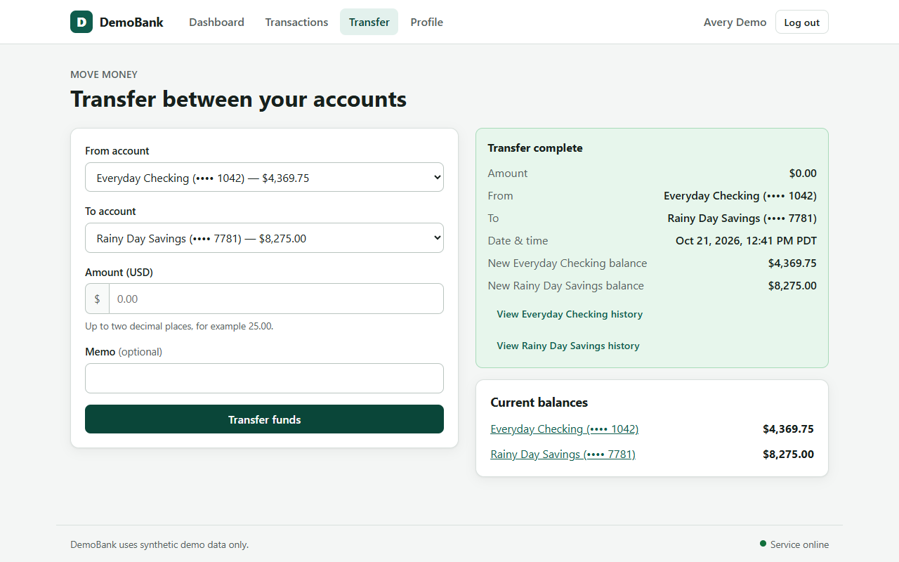
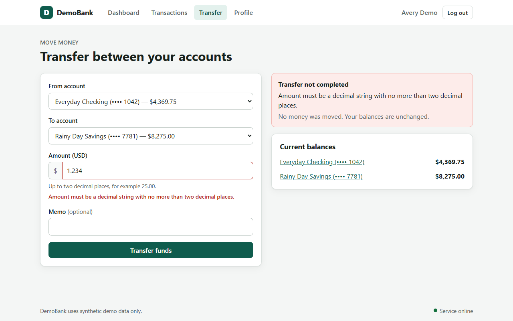

# DemoBank QA Audit

Generated: 2026-10-21T19:41:14.798561+00:00

**Verdicts:** 3 PASSED / 2 FAILED / 27 UNVERIFIED across 32 traceable PRD clauses.

**Ingestion:** Gemini gemini-3.5-flash-lite (source quotes preserved)

Execution blocked ≠ application failed. Unexecuted requirements stay UNVERIFIED.

## Requirement traceability

| PRD ID | Section | Verdict | Scenario(s) |
|---|---|---|---|
| PRD-001 | Users and access | **UNVERIFIED** | not yet implemented |
| PRD-002 | Users and access | **PASSED** | login |
| PRD-003 | Users and access | **UNVERIFIED** | not yet implemented |
| PRD-004 | Users and access | **PASSED** | logout |
| PRD-005 | Users and access | **UNVERIFIED** | not yet implemented |
| PRD-006 | Dashboard and accounts | **UNVERIFIED** | not yet implemented |
| PRD-007 | Dashboard and accounts | **PASSED** | dashboard |
| PRD-008 | Dashboard and accounts | **UNVERIFIED** | not yet implemented |
| PRD-009 | Dashboard and accounts | **UNVERIFIED** | not yet implemented |
| PRD-010 | Dashboard and accounts | **UNVERIFIED** | not yet implemented |
| PRD-011 | Transfers between owned accounts | **UNVERIFIED** | not yet implemented |
| PRD-012 | Transfers between owned accounts | **UNVERIFIED** | not yet implemented |
| PRD-013 | Transfers between owned accounts | **UNVERIFIED** | not yet implemented |
| PRD-014 | Transfers between owned accounts | **FAILED** | zero, precision |
| PRD-015 | Transfers between owned accounts | **UNVERIFIED** | not yet implemented |
| PRD-016 | Transfers between owned accounts | **UNVERIFIED** | not yet implemented |
| PRD-017 | Transfers between owned accounts | **UNVERIFIED** | not yet implemented |
| PRD-018 | Transfers between owned accounts | **UNVERIFIED** | not yet implemented |
| PRD-019 | Transfers between owned accounts | **UNVERIFIED** | not yet implemented |
| PRD-020 | Transaction history | **UNVERIFIED** | not yet implemented |
| PRD-021 | Transaction history | **UNVERIFIED** | not yet implemented |
| PRD-022 | Transaction history | **UNVERIFIED** | not yet implemented |
| PRD-023 | Transaction history | **FAILED** | single_day |
| PRD-024 | Transaction history | **UNVERIFIED** | not yet implemented |
| PRD-025 | Transaction history | **UNVERIFIED** | not yet implemented |
| PRD-026 | Profile | **UNVERIFIED** | not yet implemented |
| PRD-027 | Profile | **UNVERIFIED** | not yet implemented |
| PRD-028 | General interface behavior | **UNVERIFIED** | not yet implemented |
| PRD-029 | General interface behavior | **UNVERIFIED** | not yet implemented |
| PRD-030 | General interface behavior | **UNVERIFIED** | not yet implemented |
| PRD-031 | General interface behavior | **UNVERIFIED** | not yet implemented |
| PRD-032 | General interface behavior | **UNVERIFIED** | not yet implemented |

## Scenario-level evidence

### login — PASSED
- **Requirement:** PRD-002 (Users and access)
- **PRD quote:** The landing page provides a clearly labeled **Enter Demo** action. It opens the demo dashboard without requiring a password or real identity information.
- **Execution:** ok
- **Expected:** Dashboard with active customer and two account cards, no password
- **Observed:** URL=http://localhost:5173/dashboard, active=Signed in as
Avery Demo, cards=2
- **Rationale:** Verified resulting dashboard state after Enter Demo.
- **Reproduction steps:**
  1. Navigate to landing
  2. Click Enter Demo
  3. Assert dashboard and active customer
- **Screenshot (at assertion):** 
- **DOM excerpt:** `Skip to main content D DemoBank Dashboard Transactions Transfer Profile Signed in as Avery Demo Log out  DASHBOARD  Welcome, Avery Demo Transfer funds View all transactions Your accounts Everyday Checking Checking  Account number ending •••• 1042  Available balance  $4,369.75USD  View details → Rainy Day Savings Savings  Account number ending •••• 7781  Available balance  $8,275.00USD  View details → DemoBank uses synthetic demo data only. Service online`

### dashboard — PASSED
- **Requirement:** PRD-007 (Dashboard and accounts)
- **PRD quote:** Each account displays a readable account name, a masked account identifier, account type, and current available balance in USD.
- **Execution:** ok
- **Expected:** Both account names, masked identifiers, and two-decimal USD balances match authenticated API
- **Observed:** [{'name': 'Everyday Checking', 'expected_balance': '4369.75', 'shown_balance': '$4,369.75USD', 'expected_mask': '•••• 1042', 'shown_mask': '•••• 1042', 'match': True}, {'name': 'Rainy Day Savings', 'expected_balance': '8275.00', 'shown_balance': '$8,275.00USD', 'expected_mask': '•••• 7781', 'shown_mask': '•••• 7781', 'match': True}]
- **Rationale:** UI values checked against live API values; mismatched or missing card constitutes defect.
- **Reproduction steps:**
  1. Enter Demo
  2. Read two account cards
  3. Compare rendered balances with API
- **Screenshot (at assertion):** 
- **DOM excerpt:** `Skip to main content D DemoBank Dashboard Transactions Transfer Profile Signed in as Avery Demo Log out  DASHBOARD  Welcome, Avery Demo Transfer funds View all transactions Your accounts Everyday Checking Checking  Account number ending •••• 1042  Available balance  $4,369.75USD  View details → Rainy Day Savings Savings  Account number ending •••• 7781  Available balance  $8,275.00USD  View details → DemoBank uses synthetic demo data only. Service online`

### logout — PASSED
- **Requirement:** PRD-004 (Users and access)
- **PRD quote:** Logging out returns the user to the landing page. Protected dashboard views should not remain usable after logout; direct navigation to them should return the user to the landing page or an access-required state.
- **Execution:** ok
- **Expected:** After logout, direct /dashboard navigation is blocked
- **Observed:** Final URL=http://localhost:5173/, Enter Demo visible=True
- **Rationale:** Direct protected-route navigation checked after logout, not just logout click.
- **Reproduction steps:**
  1. Enter Demo
  2. Click Log out
  3. Navigate directly to /dashboard
  4. Assert access blocked
- **Screenshot (at assertion):** 
- **DOM excerpt:** `D DemoBank Your accounts, in one simple dashboard.  Explore a fictional checking and savings account, review transaction history, and move money between your own accounts. No password needed, and every record is synthetic.  Access required: enter the demo to view that page. Enter Demo  DemoBank never connects to a real bank or moves real money.  Service online`

### single_day — FAILED
- **Requirement:** PRD-023 (Transaction history)
- **PRD quote:** The start and end dates are inclusive. A transaction occurring on either boundary date must be included when it matches the other filters.
- **Execution:** ok
- **Expected:** For inclusive date 2025-06-15, visible transaction IDs include ['00000000-0000-0000-0000-000000000208']
- **Observed:** Visible IDs=[]; missing=['00000000-0000-0000-0000-000000000208']
- **Rationale:** Expected IDs taken from unfiltered authenticated transaction data, not the broken date-filter response.
- **Reproduction steps:**
  1. Enter Demo
  2. Get an existing transaction and its Pacific date
  3. Apply same-day start/end filters
  4. Assert transaction is present
- **Screenshot (at assertion):** 
- **DOM excerpt:** `Skip to main content D DemoBank Dashboard Transactions Transfer Profile Signed in as Avery Demo Log out  HISTORY  Transactions Account All accounts Everyday Checking (•••• 1042) Rainy Day Savings (•••• 7781) Type All types Deposit Withdrawal Transfer Status All statuses Completed Pending Failed Start date End date  Start and end dates are inclusive and use Pacific Time.  Apply filters Clear filters Filtered results No transactions match these filters  Try a different combination, or clear the filters to see all transactions.  Clear filters DemoBank uses synthetic demo data only. Service online`

### zero — FAILED
- **Requirement:** PRD-014 (Transfers between owned accounts)
- **PRD quote:** Amount must be a positive number greater than zero, with no more than two digits after the decimal point. Blank, zero, negative, non-numeric, and over-precision values must be rejected with a clear validation message. Rejected input must not create a transaction or change balances.
- **Execution:** ok
- **Expected:** Amount '0' rejected with visible error; no balance change; no added transaction
- **Observed:** error_visible=False, success_visible=True, before_balances={'00000000-0000-0000-0000-000000000101': '4369.75', '00000000-0000-0000-0000-000000000102': '8275.00'}, after_balances={'00000000-0000-0000-0000-000000000101': '4369.75', '00000000-0000-0000-0000-000000000102': '8275.00'}, added_txns=['86e07032-05da-4cf3-8d77-9457ba0f9136'], removed_txns=[]
- **Rationale:** Invalid transfer judged on UI feedback AND actual account/transaction state.
- **Reproduction steps:**
  1. Enter Demo
  2. Read balances/transactions
  3. Submit transfer amount 0
  4. Assert rejection and no state change
- **Screenshot (at assertion):** 
- **DOM excerpt:** `Skip to main content D DemoBank Dashboard Transactions Transfer Profile Signed in as Avery Demo Log out  MOVE MONEY  Transfer between your accounts From account Select an account Everyday Checking (•••• 1042) — $4,369.75 Rainy Day Savings (•••• 7781) — $8,275.00 To account Select an account Everyday Checking (•••• 1042) — $4,369.75 Rainy Day Savings (•••• 7781) — $8,275.00 Amount (USD) $  Up to two decimal places, for example 25.00.  Memo (optional) Transfer funds Transfer complete Amount $0.00 From Everyday Checking (•••• 1042) To Rainy Day Savings (•••• 7781) Date & time Oct 21, 2026, 12:41 PM PDT New Everyday Checking balance $4,369.75 New Rainy Day Savings balance $8,275.00 View Everyday Checking history View Rainy Day Savings history Current balances Everyday Checking (•••• 1042) $4,3`

### precision — PASSED
- **Requirement:** PRD-014 (Transfers between owned accounts)
- **PRD quote:** Amount must be a positive number greater than zero, with no more than two digits after the decimal point. Blank, zero, negative, non-numeric, and over-precision values must be rejected with a clear validation message. Rejected input must not create a transaction or change balances.
- **Execution:** ok
- **Expected:** Amount '1.234' rejected with visible error; no balance change; no added transaction
- **Observed:** error_visible=True, success_visible=False, before_balances={'00000000-0000-0000-0000-000000000101': '4369.75', '00000000-0000-0000-0000-000000000102': '8275.00'}, after_balances={'00000000-0000-0000-0000-000000000101': '4369.75', '00000000-0000-0000-0000-000000000102': '8275.00'}, added_txns=[], removed_txns=[]
- **Rationale:** Invalid transfer judged on UI feedback AND actual account/transaction state.
- **Reproduction steps:**
  1. Enter Demo
  2. Read balances/transactions
  3. Submit transfer amount 1.234
  4. Assert rejection and no state change
- **Screenshot (at assertion):** 
- **DOM excerpt:** `Skip to main content D DemoBank Dashboard Transactions Transfer Profile Signed in as Avery Demo Log out  MOVE MONEY  Transfer between your accounts From account Select an account Everyday Checking (•••• 1042) — $4,369.75 Rainy Day Savings (•••• 7781) — $8,275.00 To account Select an account Everyday Checking (•••• 1042) — $4,369.75 Rainy Day Savings (•••• 7781) — $8,275.00 Amount (USD) $  Up to two decimal places, for example 25.00.  Amount must be a decimal string with no more than two decimal places.  Memo (optional) Transfer funds Transfer not completed  Amount must be a decimal string with no more than two decimal places.  No money was moved. Your balances are unchanged.  Current balances Everyday Checking (•••• 1042) $4,369.75 Rainy Day Savings (•••• 7781) $8,275.00 DemoBank uses synt`

## API / token cost

- LLM calls: 1
- Input tokens: 1378
- Output tokens: 2522
- Estimated API spend (USD): 0.0067184
- Replay/verification LLM calls: 0
- Note: Set INPUT_USD_PER_M_TOKENS and OUTPUT_USD_PER_M_TOKENS to estimate billed costs. Null means prices were not provided.

## Reset log

- login: migrations+seed reset OK
- dashboard: migrations+seed reset OK
- logout: migrations+seed reset OK
- single_day: migrations+seed reset OK
- zero: migrations+seed reset OK
- precision: migrations+seed reset OK
